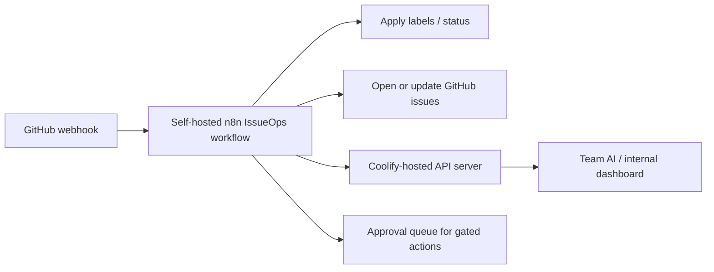

# n8n GitHub IssueOps Bridge

Use this bridge when GitHub should hand operational work to self-hosted n8n,
Coolify, or the API server.

## Recommended Events

- `issues`
- `issue_comment`
- `pull_request`
- `workflow_run`

## Required Secrets

Store these in n8n credentials or the API server environment, not in GitHub:

- GitHub webhook secret for validating `X-Hub-Signature-256`.
- GitHub token with the minimum repository scopes required for issue labels and comments.
- Optional API server bearer or edge secret for Coolify-hosted service calls.

## Safe Default Behaviour

The bridge may automatically:

- Add labels.
- Add comments with diagnostic context.
- Open follow-up issues for failed workflows.
- Notify Team AI or an internal dashboard.

The bridge must not automatically:

- Send emails.
- Delete CRM records.
- Bulk-write CRM records.
- Publish to production social channels.
- Trigger finance writes.

Those actions are queued as `needs:decision` issues or internal pending approvals.

## Flow

